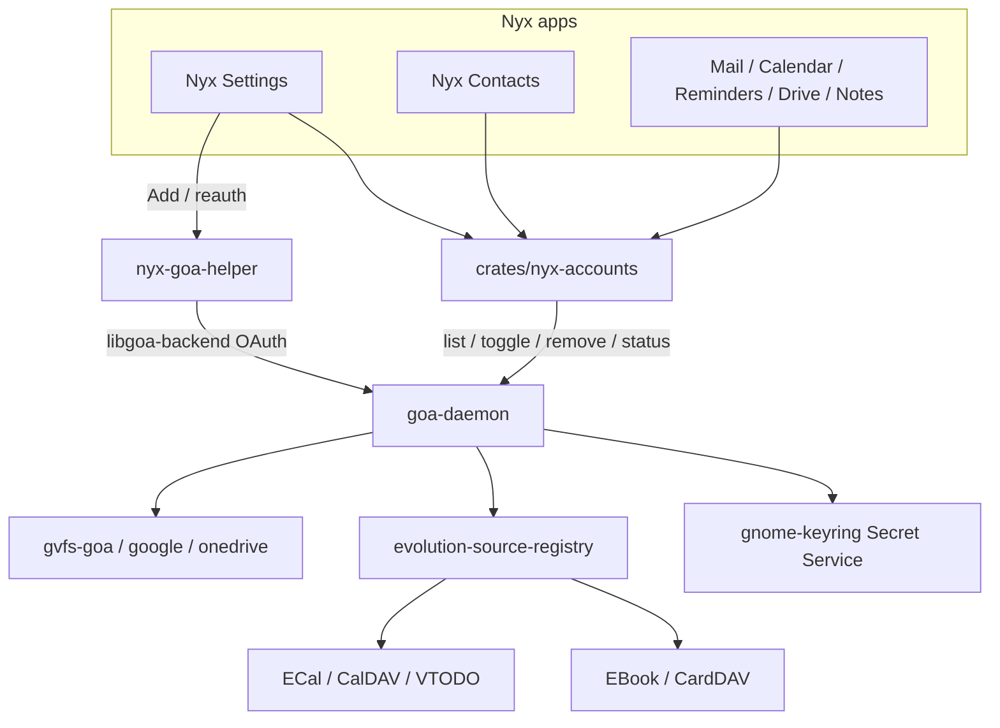
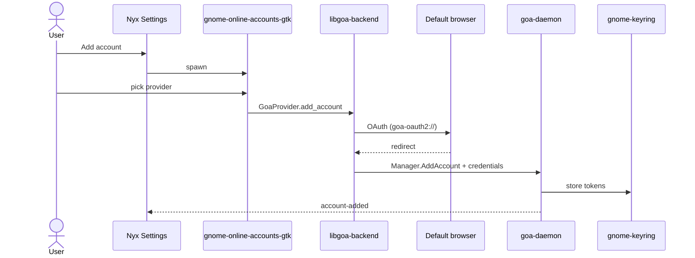

# Architecture

Nyx Online Accounts is a thin client of services that already exist on the session bus.

## Principle

Reuse GOA for identity and authentication, EDS for PIM sync, and provider libraries (rclone, `nyx-sync`) only where GOA/EDS do not cover the job. Do not invent a second account database.

## Context

## Why there is no `nyx-accountsd`

`MAIL_PLAN.md` Phase 0 argued for a Nyx daemon so Settings and Mail would not race on SQLite and would not copy refresh tokens. GOA already:

- Owns `~/.config/goa-1.0/accounts.conf` (no access/refresh tokens; Microsoft may store GNOME OAuth2 URIs and client id)
- Stores tokens in Secret Service
- Serializes credential refresh
- Emits `account-added` / `account-changed` / `account-removed`
- Hands tokens to same-uid consumers through `org.gnome.OnlineAccounts.OAuth2`

A second daemon would duplicate that, split identity from EDS, and still need GOA for Google/Microsoft OAuth client IDs.

Passwords’ `nyx-passwordsd` remains the pattern for **Nyx-owned** secrets (Vaultwarden). Online accounts are not Nyx-owned.

## Crate

`crates/nyx-accounts` (workspace member, no GTK):

| API | Role |
| --- | --- |
| `Client::connect()` | Session bus, `org.gnome.OnlineAccounts`. Error: “Online Accounts isn’t available.” |
| `list()` / `get(id)` | Metadata only |
| `by_provider(type)` | Filter |
| `services(id)` | Interfaces present on the object (Mail, Calendar, Contacts, Files, …) |
| `set_service_enabled(id, service, bool)` | Writes `MailDisabled` etc. when that property exists |
| `remove(id)` | `GoaAccount.Remove` |
| `ensure_credentials(id)` | Status / `expires_in`; does not complete OAuth |
| `subscribe(Change)` | GOA signals |
| `open_management()` | Launch `gnome-online-accounts-gtk` |

Tokens never appear on a Nyx bus name. Apps that need an access token (Mail's `nyx-maild`, or a later Drive adapter) call GOA’s OAuth2 interface in-process, or let EDS do it.

Binding: **gio 0.22 D-Bus** (GTK main loop). Not crates.io `goa` 0.0.3, not zbus/tokio, not `libgoa-backend` from Settings.

## Settings page

| | |
| --- | --- |
| File | `apps/settings/src/sections/online_accounts.rs` |
| Section id | `online-accounts` |
| Title | Online Accounts |
| Group | Accounts (after Users) |
| Style | `STYLE.md`; Music/Settings widgets; `page.group` + `widgets::row` |

Users (`id: accounts`) stays OS users. Search keywords for the new page: google microsoft nextcloud webdav imap oauth accounts email calendar contacts.

### Main screen

- One row per GOA account: provider icon (`ProviderIcon` serialized GIcon, fallback symbolic), `PresentationIdentity`, service chips from interfaces actually on the object, status (`AttentionNeeded` → needs sign-in; else connected), Manage.
- Add account button.
- Missing GOA / missing helper / missing keyring banners, same pattern as the Settings helper-missing banner.

### Detail screen

- Identity, provider name, connection status.
- Switches only for services GOA exposes on that account (`MailDisabled` inverted, and so on).
- Sign in again → helper.
- Remove → confirm: “This disconnects the account from this computer. Mail, events, contacts, and files on the provider are not deleted.”

Provider-specific extra settings that only exist in `libgoa-backend` (`show_account`) are reached by opening the helper, not by cloning those widgets.

## Add and reauthenticate

Two GOA surfaces exist. They are not interchangeable. See [GOA_RESEARCH.md](GOA_RESEARCH.md).

**Chosen path:** Nyx-native list/detail **and** provider picker. Add/reauth spawn `nyx-goa-helper`, which links `libgoa-backend` in a separate process (browser OAuth, GNOME client IDs). Settings does not link libadwaita. `gnome-online-accounts-gtk` remains a fallback if the helper is missing.

Rejected for Phase 1–2:

1. Embed `GoaProvider` in Settings — pulls libadwaita widgets into a Nyx window.
2. Custom OAuth + `Manager.AddAccount` — copies GNOME client IDs or needs Nyx app registrations; high maintenance.
3. `gnome-control-center` — depends on `gnome-shell`.

## EDS

GOA does not sync PIM data. `evolution-source-registry` watches GOA and creates collection `ESource`s (`ESourceGoa`). Children are mail identities (unused by Nyx), CardDAV books, CalDAV calendars, VTODO lists.

Settings does not require EDS. Contacts/Calendar/Reminders/Mail do, when those apps want provider sync. See [EDS_INTEGRATION.md](EDS_INTEGRATION.md).

## Later apps

| App | Account use | Sync |
| --- | --- | --- |
| Contacts | GOA identity; EDS books as extra sources | EDS CardDAV |
| Calendar | GOA identity; EDS calendars | EDS CalDAV |
| Reminders | EDS tasks / VTODO; extra local metadata allowed | EDS |
| Mail | GOA identity, `Mail` settings and in-process credentials | `nyx-maild` IMAP/SMTP |
| Drive | GOA Files if the interface exists; rclone stays for the rest | GVFS or rclone, not both on one token |
| Notes | Local Markdown; optional `nyx-sync` WebDAV | Not GOA |

## Files on disk

| Path | Owner | Secrets? |
| --- | --- | --- |
| `~/.config/goa-1.0/accounts.conf` | goa-daemon | no |
| gnome-keyring items (private schema) | goa-daemon | yes |
| `~/.config/evolution/sources/` | EDS | no |
| `~/.local/share/nyx-contacts/contacts.db` | Nyx Contacts | no (local) |
| Nyx `settings.toml` | Nyx | never tokens |

## Omarchy session

Works without GNOME Shell. Needs:

- session D-Bus (already)
- `goa-daemon` D-Bus activation from `gnome-online-accounts`
- Secret Service (already `gnome-keyring-daemon`)
- default browser + `goa-oauth2-handler` for redirects
- Wayland portals already present (`xdg-desktop-portal-hyprland`, `-gtk`)
