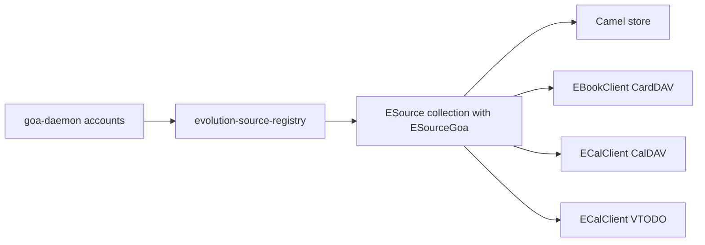

# EDS integration

Evolution Data Server is the sync engine for mail, calendar, contacts, and tasks. GOA does not sync those. Investigate EDS separately from GOA, then join them at `ESourceGoa`.

## Packages

Arch `evolution-data-server` 3.62.1-1 (installed here 2026-10-20).

Provides: `libcamel-1.2`, `libebook-1.2`, `libecal-2.0`, `libedataserver-1.2`, `libebackend-1.2`, …

Depends on: gtk3, webkit2gtk-4.1, libgoa, libical, libsecret, libsoup3, nss, …

Optional split: `libedataserverui4` (GTK4 credential prompts / WebDAV discover widgets). Nyx should avoid that UI library (WebKitGTK 6). Use D-Bus/`libedataserver` only.

`evolution-ews` is a **separate** package for Exchange / Microsoft 365 Camel and calendar backends. Without it, a GOA M365 account may only expose Files (OneDrive).

## How GOA and EDS meet

The registry module creates a collection source whose `ESourceGoa` extension stores the GOA account id. Children are mail identity/transport, address books, calendars, task lists. Enabling/disabling a GOA service should make the registry add or drop the matching children (asynchronously).

On-disk: `~/.config/evolution/sources/*.source`. Cache under `~/.cache/evolution/`. Nyx must not edit those files.

## Contacts

Current Nyx Contacts:

- App id `io.github.design_nexus.nyx.Contacts`
- Store: `$XDG_DATA_HOME/nyx-contacts/contacts.db` (SQLite `user_version=1`, JSON rows)
- No network, no CardDAV
- README: “Account synchronization … outside this local release”

**Phase 3 rule:** keep the local book. When EDS is running, show EDS address books as additional sources in the sidebar. Do not migrate rows into EDS automatically. Do not delete `contacts.db` when a GOA account is removed (GOA Remove already does not delete remote cards; the local book is unrelated).

Read path: `ESourceRegistry` → address book sources → `EBookClient` / `EBookClientView`. Prefer D-Bus or a small GIR crate later; do not take `libedataserverui4`.

Duplicates across local + Google should stay a review UI (Contacts already has Duplicates for the local book).

## Calendar and Reminders

No Nyx Calendar/Reminders GTK apps exist in the workspace yet (Assistant has a reminders plugin). When they are built:

- Calendars: EDS `ECalClient` (CalDAV, Google via EDS, M365 via evolution-ews)
- Tasks: EDS VTODO lists. TickTick-style extras (priority views, local metadata) may live in a Nyx sidecar keyed by EDS uid; they are not GOA capabilities.

## Mail decision

**Superseded (2026-10-21).** Mail does not use Camel. Nyx Mail runs its own IMAP/SMTP engine (`nyx-maild`) and takes server settings from the GOA `Mail` interface and credentials from GOA `OAuth2` / `Password` in-process, for each connection. Nothing is copied or stored. Reasons and details: [../pim/ARCHITECTURE.md](../pim/ARCHITECTURE.md#why-mail-is-not-in-eds).

Message bodies render in a locked-down WebKitGTK 6 view inside the Mail UI (no JavaScript, no network unless images are allowed). EDS is still the engine for calendars, task lists and address books.

## Drive and Notes

- **Drive:** keep rclone (and any existing storage code). `gvfs-goa` / `gvfs-google` / `gvfs-onedrive` may mount GOA Files in the portal file chooser. Do not feed GOA tokens to rclone; the secret format is private and the OAuth client is GNOME’s.
- **Notes:** local Markdown remains sufficient. Optional Nextcloud via `nyx-sync` WebDAV with that crate’s own `secret-tool` attributes, until/unless a later phase points `nyx-sync` at a GOA WebDAV account **without** copying the token into Nyx config (EDS/GVfs, or a locked GOA Password interface call in-process).

## Rust bindings

There is no maintained gtk-rs EDS crate. Options for Phase 3:

1. zbus against `org.gnome.evolution.dataserver.*` (source registry, address book factory)
2. GIR-generate `libedataserver` / `libebook` as workspace crates
3. Spawn `evolution-data-server` tools — reject (argv secrets, brittle)

Prefer (1) for discovery; (2) if views and photo fields need the GObject API.

## Availability

EDS is **optional**. Settings Online Accounts works with GOA alone. Contacts works with the local DB alone. If EDS is missing, hide provider books and say “Install evolution-data-server to sync contacts.”

## Limitations

- EDS pulls gtk3 + webkit2gtk-4.1 even if Nyx never opens those widgets.
- M365 PIM needs `evolution-ews`.
- Google contacts are CardDAV now (GData Contacts API is gone).
- Registry GOA module can race (upstream deadlock reports with M365 + Camel). Treat “EDS not answering” as an error state.
- Credential prompts in EDS UI are Adwaita/GTK; Nyx should send the user to Settings → Online Accounts / the GOA helper instead of embedding `ECredentialsPrompter`.
