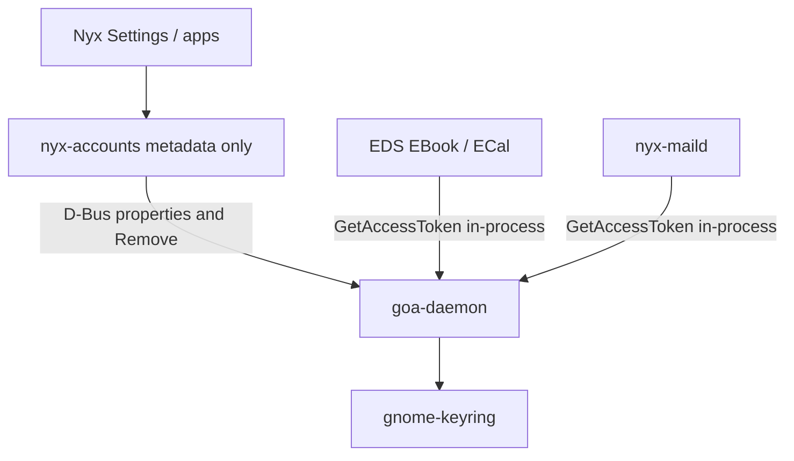

# Security

Authentication stays in GOA and the session keyring. Nyx displays accounts and asks GOA to change flags or remove them.

## Rules

1. Do not store OAuth access or refresh tokens in Nyx config, SQLite, or environment files.
2. Do not log tokens, passwords, `credentials` variants, or `secret-tool` stdout.
3. Do not pass secrets on command lines (`gnome-online-accounts-gtk` is launched with no token args).
4. Do not parse `~/.config/goa-1.0/accounts.conf` or GOA keyring items.
5. Do not re-export `GetAccessToken` / `GetPassword` on a Nyx D-Bus name.
6. Do not copy GNOME’s Google/Microsoft client IDs into Nyx source.
7. `Remove()` is local disconnect only. Copy must say remote mail, events, contacts, and files stay on the provider.
8. `EnsureCredentials` failure is “needs sign-in” or “keyring locked”, never a green connected state.
9. Request no extra OAuth scopes. GOA’s provider defines scopes.
10. Locked GOA accounts (`IsLocked`) are not removable from the Nyx UI.

## Credential boundary

Settings never needs a token. Contacts Phase 3 talks to EDS, which talks to GOA. Mail/Calendar later do the same.

If a future Nyx binary must call `OAuth2.GetAccessToken` itself (for example Drive without GVFS), that call stays in-process in that binary, result in a redacted `Secret` type (see `nyx-sync::credentials::Secret`), never in a log or a broadcast signal.

## Keyring

This machine already runs `gnome-keyring-daemon` as the Secret Service. GOA documents GNOME Keyring as its store. If Secret Service is missing:

- Add-account fails
- Settings banner: “The keyring isn’t available. Online accounts cannot be saved.”

Do not fall back to plaintext.

## Session and uid

GOA is a **user** session service. Same-uid D-Bus is the access control. That is weaker than a grant table (`MAIL_PLAN.md` wanted app-id grants). Accepting GOA means any same-uid process can already list accounts and, if it speaks the OAuth2 interface, fetch tokens. Adding a Nyx daemon would not close that hole unless it replaced GOA.

Nyx still must not make it easier (no `ListSecrets` on `io.github.design_nexus.nyx.Accounts`).

## Browser OAuth

Redirect URI handling is `goa-oauth2-handler`. Nyx does not register extra URI schemes. Phishing risk is the same as GNOME’s helper: the browser shows GNOME’s app name, not “Nyx”. That is required if we use GOA’s client IDs.

## Revocation

User revokes GNOME at Google/Microsoft account settings → next `EnsureCredentials` fails → `AttentionNeeded`. Nyx shows Sign in again (helper) or Remove.

Removing the GOA account deletes local GOA config and keyring items for that account. EDS then drops collection sources. Local Nyx Contacts DB is untouched. rclone remotes are untouched.

## Logging

`nyx-accounts` `Debug` for account structs: id, provider, presentation identity, flags. No identity passwords. Worker errors mapped to short sentences before they hit `window::toast`.

## In-process credentials (`credentials` feature)

`nyx-accounts` has `Client::access_token` and `Client::password` only when built with
the `credentials` feature. Nyx Mail's engine (`nyx-maild`) enables it; Settings and
Contacts do not. Both return a redacted `Secret` that is overwritten when dropped. The
engine fetches one for each connection and never stores, logs or re-exports it.

## Review checklist (Phase 5)

- [x] `rg` on the crate: no `access_token`, `refresh_token`, `client_secret` literals (2026-10-20). Since 2026-10-21 the `access_token` method exists, behind the `credentials` feature; there are still no token literals
- [x] crate tests have no token fixtures; live `accounts.conf` has Provider/Identity (Google) plus GNOME OAuth2 URIs/client id with empty ClientSecret (Microsoft). No access/refresh tokens in that file. Nyx does not parse it.
- [x] clippy + tests without a real token
- [x] helper launched with argv that is only the binary name (`Command::new(HELPER)` with no args)
